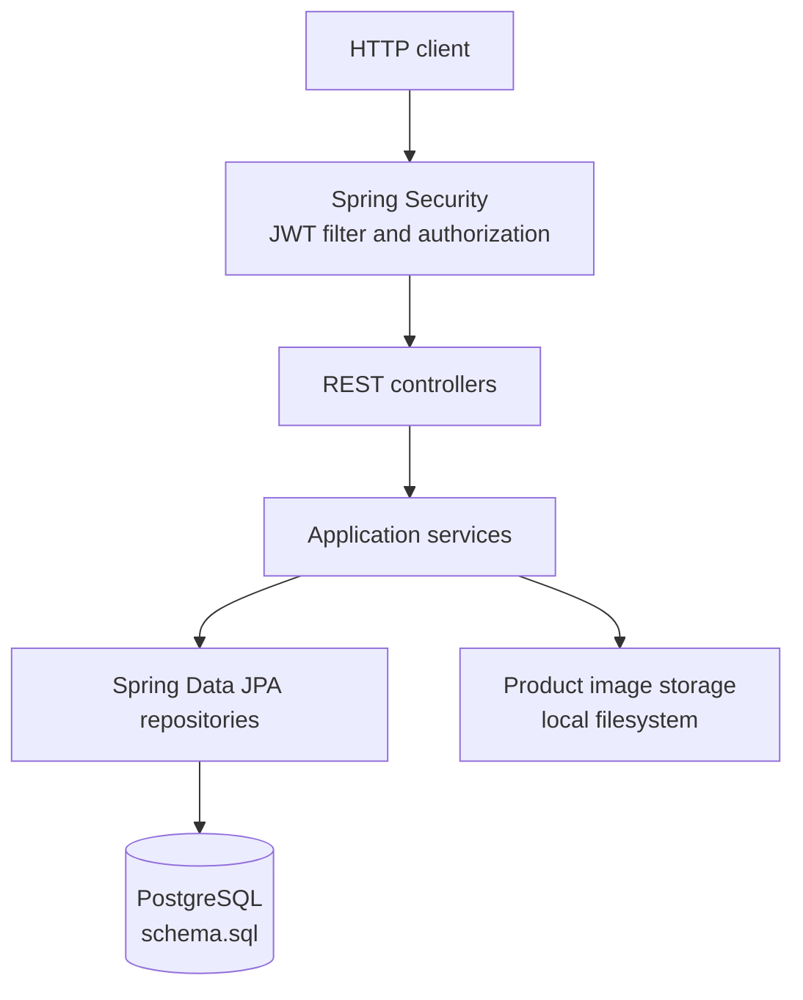

# Philips Online Store Backend

A REST API backend for an online store, built as a Java 21 and Spring Boot application. It provides customer authentication, product and category catalog operations, shopping carts, order placement, mock payment processing, and product image storage.

The repository contains the backend application and its automated tests. Payment processing is simulated; this project does not integrate with a real payment provider.

## Project Objectives

- Provide a modular REST backend for core online-store workflows.
- Protect customer and administrative operations with stateless JWT authentication.
- Persist catalog, cart, order, and payment data in PostgreSQL.
- Keep uploaded product images in filesystem storage rather than database blobs.
- Demonstrate validation, transactional service operations, payment idempotency, and automated testing.

## Technology Stack

| Area | Technology |
|---|---|
| Language | Java 21 |
| Application framework | Spring Boot 3.5.6 |
| Build | Maven |
| REST | Spring MVC |
| Persistence | Spring Data JPA and Hibernate |
| Database | PostgreSQL |
| Security | Spring Security and JWT (JJWT 0.12.6) |
| Validation | Jakarta Bean Validation |
| Image support | Java ImageIO and WebP ImageIO |
| Testing | JUnit 5, Mockito, Spring Boot Test, H2 |

## Architecture Overview

The application is a single Spring Boot backend. HTTP controllers validate and route requests to services; services coordinate repositories, security, and filesystem image storage.



## Project Package Structure

```text
src/
├── main/
│   ├── java/com/philips/onlinestore/
│   │   ├── bootstrap/     # Configurable local startup utilities
│   │   ├── config/        # Security and password encoder configuration
│   │   ├── controller/    # REST endpoints
│   │   ├── dto/           # Request and response records
│   │   ├── entity/        # JPA entities and enums
│   │   ├── exception/     # API exception types and error handling
│   │   ├── repository/    # Spring Data JPA repositories
│   │   ├── security/      # JWT filter and user detail service
│   │   └── service/       # Service interfaces and implementations
│   └── resources/
│       ├── application.properties
│       ├── application-local.properties
│       └── schema.sql
└── test/java/com/philips/onlinestore/
    ├── bootstrap/
    ├── controller/
    ├── dto/
    ├── entity/
    ├── security/
    └── service/
```

## Implemented Features and Modules

- **Authentication and users:** customer registration and login, password encoding, user lookup, and JWT issuance.
- **Catalog:** category and product creation, retrieval, update, and deletion. Product listing supports search, category and active-state filters, and pagination.
- **Shopping cart:** retrieve a customer’s cart, add or update items, remove an item, and clear the cart.
- **Orders:** place an order from the authenticated customer’s cart and retrieve that customer’s orders.
- **Payments:** process a simulated `SUCCESS` or `FAILURE` payment outcome. A failed payment restores product stock.
- **Product images:** validate and store image uploads on the filesystem, retrieve an image, and replace an existing product image.
- **Local bootstrap utilities:** optional local-profile startup helpers for admin setup and customer password reset.
- **Error responses:** API exceptions are mapped to a consistent JSON error response.

## Database Design and Entity Relationships

`src/main/resources/schema.sql` defines the PostgreSQL tables and constraints. The JPA entities map to:

| Entity | Table | Relationship summary |
|---|---|---|
| `User` | `users` | Has a one-to-one cart; owns orders |
| `Category` | `categories` | A category can be assigned to many products |
| `Product` | `products` | Belongs to one category |
| `Cart` | `carts` | Belongs to one user; contains cart items |
| `CartItem` | `cart_items` | Belongs to one cart and references one product |
| `Order` | `orders` | Belongs to one user; contains order items |
| `OrderItem` | `order_items` | Belongs to one order and references one product |
| `Payment` | `payments` | References an order |

The schema includes uniqueness constraints for user email and product SKU, a unique user-to-cart relationship, a unique product per cart, and a unique `(order_id, idempotency_key)` payment pair. Order items retain product name, SKU, unit price, quantity, and subtotal values as order-time snapshots. `UserRole`, `OrderStatus`, and `PaymentStatus` are enums, not separate tables.

## REST API

All endpoints are under `/api/v1`. Unless an endpoint is marked **Public**, it requires a valid bearer JWT. Product and category write operations require the `ADMIN` role; cart, order, and payment operations require authentication.

| Method | Path | Access | Purpose |
|---|---|---|---|
| `POST` | `/api/v1/auth/register` | Public | Register a customer |
| `POST` | `/api/v1/auth/login` | Public | Authenticate and obtain a JWT |
| `GET` | `/api/v1/health` | Public | Health response |
| `GET` | `/api/v1/categories` | Public | List categories |
| `GET` | `/api/v1/categories/{id}` | Public | Get a category |
| `POST` | `/api/v1/categories` | Admin | Create a category |
| `PUT` | `/api/v1/categories/{id}` | Admin | Update a category |
| `DELETE` | `/api/v1/categories/{id}` | Admin | Delete a category |
| `GET` | `/api/v1/products` | Public | Search and page products |
| `GET` | `/api/v1/products/{id}` | Public | Get a product |
| `GET` | `/api/v1/products/{id}/image` | Public | Retrieve a product image |
| `POST` | `/api/v1/products` | Admin | Create a product |
| `PUT` | `/api/v1/products/{id}` | Admin | Update a product |
| `POST` | `/api/v1/products/{id}/image` | Admin | Upload a product image |
| `PUT` | `/api/v1/products/{id}/image` | Admin | Replace a product image |
| `DELETE` | `/api/v1/products/{id}` | Admin | Delete a product |
| `GET` | `/api/v1/cart` | Authenticated | Get the customer’s cart |
| `POST` | `/api/v1/cart/items` | Authenticated | Add an item |
| `PUT` | `/api/v1/cart/items/{itemId}` | Authenticated | Update an item quantity |
| `DELETE` | `/api/v1/cart/items/{itemId}` | Authenticated | Remove an item |
| `DELETE` | `/api/v1/cart` | Authenticated | Clear the cart |
| `POST` | `/api/v1/orders` | Authenticated | Place an order from the cart |
| `GET` | `/api/v1/orders` | Authenticated | List the customer’s orders |
| `GET` | `/api/v1/orders/{orderId}` | Authenticated | Get one of the customer’s orders |
| `POST` | `/api/v1/orders/{orderId}/payments` | Authenticated | Submit a simulated payment |

Product listing accepts optional `search`, `categoryId`, and `active` query parameters, plus Spring pageable parameters. The configured defaults are page size `20` and sort by `name` ascending.

The controllers explicitly return `201 Created` for registration, category/product creation, and order placement; category/product creation and order placement include a `Location` header. Delete operations return `204 No Content`. Other successful operations use their controller/framework default success status.

### Request DTOs

JSON field names match the DTO record component names:

| Request | Example body |
|---|---|
| Registration | `{"fullName":"Alex Doe","email":"alex@example.com","password":"<customer-password>"}` |
| Login | `{"email":"alex@example.com","password":"<customer-password>"}` |
| Category | `{"name":"Audio","description":"Audio products"}` |
| Product | `{"name":"Headphones","sku":"HP-001","description":"Over-ear headphones","price":49.99,"stockQuantity":10,"active":true,"categoryId":1}` |
| Add cart item | `{"productId":1,"quantity":1}` |
| Update cart item | `{"quantity":2}` |
| Mock payment | `{"simulatedOutcome":"SUCCESS"}` |

The image upload and replacement endpoints accept multipart form data with a file part named `file`.

## Authentication and Authorization

The login endpoint returns a signed JWT and user details. Send it on protected requests as:

```http
Authorization: Bearer <JWT>
```

The JWT filter validates the token, loads the current user, checks that the account is enabled, and places the user’s role authorities in the Spring Security context. Security is stateless and CSRF is disabled. Registration and login, health, and catalog read endpoints are public; catalog mutations require `ADMIN`.

JWT signing uses the `JWT_SECRET` environment variable. It must contain Base64-encoded key material that decodes to at least 32 bytes. `JWT_EXPIRATION_MS` sets token lifetime in milliseconds and defaults to `900000` (15 minutes).

## Product Image Upload and Replacement

Image content is checked rather than trusting only the client-supplied media type. The storage service supports valid JPEG/JPG, PNG, and WebP images, limits files to 5 MB and decoded image dimensions to 20 million pixels, and assigns stored files UUID-based names. The image is stored on the filesystem; the product record stores its image filename.

Image replacement is coordinated with the database transaction:

1. The new image is validated and stored.
2. The product’s image filename is updated and saved.
3. After a successful transaction commit, the old image is deleted.
4. If the transaction rolls back, the new image is deleted and the old image remains.

If saving the product fails, cleanup of the newly stored image is attempted. Cleanup deletion failures are logged. The default storage location is under the current user’s home directory; configure `APP_PRODUCT_IMAGE_STORAGE_DIRECTORY` to use another directory. The configured multipart limits are 5 MB per file and 6 MB per request.

## Exception Handling and Validation

Request DTOs use Jakarta Bean Validation and relevant path/query parameters are constrained. Invalid image contents are rejected by the image storage service. The global exception handler returns an `ApiErrorResponse` containing a timestamp, HTTP status, error, message, and request path.

Common error categories include `400 Bad Request` for validation or malformed requests, `401 Unauthorized` for authentication failures, `403 Forbidden` for access denial, `404 Not Found` for missing resources, `409 Conflict` for duplicate or conflicting operations, and `500 Internal Server Error` for storage failures. Exact status depends on the exception and endpoint; Spring Security handles authentication and authorization errors separately.

## Transactions and Payment Idempotency

Write operations use transactional service methods. Payment processing locks the order being paid and locks product rows in ascending product-ID order when restoring stock after a failed payment.

Payment requests require an `Idempotency-Key` header. The key must contain 1–128 printable ASCII characters without leading or trailing spaces. A repeated key for the same order returns the existing payment, and the database enforces uniqueness for `(order_id, idempotency_key)`. This is order-scoped idempotency, not a real payment gateway integration.

## PostgreSQL Configuration

Install and start PostgreSQL, then create the database named in `SPRING_DATASOURCE_URL` (the default configuration points to a local `philips_store` database). For example:

```sql
CREATE DATABASE philips_store;
```

The application uses PostgreSQL at runtime. `schema.sql` initializes the schema, and Hibernate automatic DDL generation is disabled. Ensure the configured database user can create and modify the project tables during initialization.

Override the datasource settings with Spring Boot environment variables rather than putting credentials in source files:

| Environment variable | Purpose |
|---|---|
| `SPRING_DATASOURCE_URL` | PostgreSQL JDBC URL, e.g. `jdbc:postgresql://localhost:5432/philips_store` |
| `SPRING_DATASOURCE_USERNAME` | PostgreSQL username |
| `SPRING_DATASOURCE_PASSWORD` | PostgreSQL password |

## Environment Variables

Set configuration in the environment where the application runs. Do not commit `.env` files, passwords, JWT key material, or local configuration containing credentials.

| Variable | Purpose |
|---|---|
| `SPRING_DATASOURCE_URL` | PostgreSQL JDBC URL |
| `SPRING_DATASOURCE_USERNAME` | Database username |
| `SPRING_DATASOURCE_PASSWORD` | Database password |
| `JWT_SECRET` | Base64-encoded JWT signing key; decodes to at least 32 bytes |
| `JWT_EXPIRATION_MS` | JWT lifetime in milliseconds; defaults to `900000` |
| `APP_PRODUCT_IMAGE_STORAGE_DIRECTORY` | Optional image storage directory override |
| `SPRING_PROFILES_ACTIVE` | Set to `local` to enable local-profile utilities |
| `APP_BOOTSTRAP_ADMIN_ENABLED` | Enable local admin bootstrap when using the local profile |
| `APP_BOOTSTRAP_ADMIN_FULL_NAME` | Optional bootstrap admin display name |
| `APP_BOOTSTRAP_ADMIN_EMAIL` | Bootstrap admin email |
| `APP_BOOTSTRAP_ADMIN_PASSWORD` | Bootstrap admin password |
| `APP_CUSTOMER_PASSWORD_RESET_ENABLED` | Enable the local customer password-reset utility |

The local admin bootstrap and customer password reset are optional local-profile utilities. Use them only with deliberate local configuration and do not use example or development credentials in a deployed environment.

## Build and Run

Requirements: Java 21, Maven, and a reachable PostgreSQL database configured as above.

Set the environment variables for your shell, then run:

```bash
mvn clean package
mvn spring-boot:run
```

The API base path is `/api/v1`. In PowerShell, environment variables can be set for the current terminal session with `$env:NAME = "value"` before invoking Maven. Supply actual credentials and generated key material locally; never place them in this README or commit them.

## Tests

Run the complete test suite with:

```bash
mvn test
```

Tests use JUnit 5 and Mockito; Spring Boot test support, MockMvc, and H2 are also configured for tests. The suite includes service and controller tests plus Spring Boot integration tests for JWT login/authorization and payment concurrency.

## Sample API Requests

Examples use `curl`; replace IDs and placeholders with values from your environment. The bearer token is a placeholder, not a real credential.

Register a customer:

```bash
curl -X POST http://localhost:8080/api/v1/auth/register \
  -H "Content-Type: application/json" \
  -d '{"fullName":"Alex Doe","email":"alex@example.com","password":"<customer-password>"}'
```

Log in and use the returned token on protected routes:

```bash
curl -X POST http://localhost:8080/api/v1/auth/login \
  -H "Content-Type: application/json" \
  -d '{"email":"alex@example.com","password":"<customer-password>"}'
```

List products with optional filters:

```bash
curl "http://localhost:8080/api/v1/products?search=headphones&active=true&page=0&size=20"
```

Add a product to the authenticated customer’s cart:

```bash
curl -X POST http://localhost:8080/api/v1/cart/items \
  -H "Authorization: Bearer <JWT>" \
  -H "Content-Type: application/json" \
  -d '{"productId":1,"quantity":1}'
```

Place an order from the cart:

```bash
curl -X POST http://localhost:8080/api/v1/orders \
  -H "Authorization: Bearer <JWT>"
```

Submit a simulated payment. Use a new idempotency key for each distinct payment operation:

```bash
curl -X POST http://localhost:8080/api/v1/orders/1/payments \
  -H "Authorization: Bearer <JWT>" \
  -H "Idempotency-Key: order-1-payment-001" \
  -H "Content-Type: application/json" \
  -d '{"simulatedOutcome":"SUCCESS"}'
```

Upload a product image as an admin:

```bash
curl -X POST http://localhost:8080/api/v1/products/1/image \
  -H "Authorization: Bearer <ADMIN-JWT>" \
  -F "file=@./product.png"
```

## Future Enhancements

The following are potential future directions and are **not currently implemented**:

- Integration with a real payment provider.
- API documentation generated with OpenAPI/Swagger.
- Object-storage integration for product images.
- Deployment-specific health, monitoring, and operational documentation.

## License

No license is currently specified in this repository.
